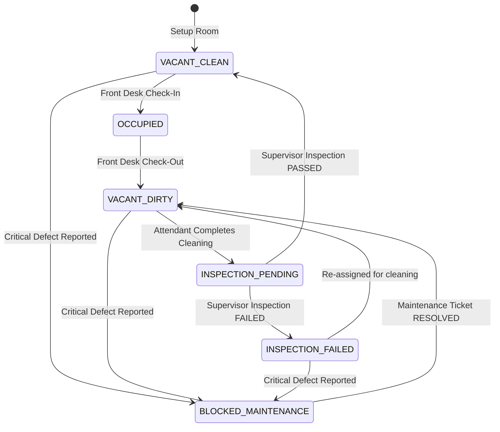
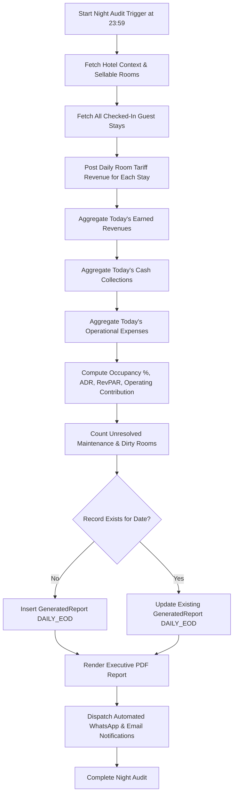

# HotelOS — Business Rules, Accounting Principles & Operational State Machines
**Version:** 1.0.0-PROD  
**Standard:** Uniform System of Accounts for the Lodging Industry (USALI 11th Revised Edition Aligned)  
**Target Platform:** Multi-Tenant Hospitality Operating System

---

## 1. Hospitality Financial Metrics & Mathematical Formulations

HotelOS adheres strictly to USALI (Uniform System of Accounts for the Lodging Industry) standards. It enforces an unambiguous separation between **accrual-based earned operational revenue** and **cash-flow collections**.

### 1.1 Key Performance Indicators (KPIs)

#### 1. Total Active Sellable Rooms ($N_{\text{sellable}}$)
Rooms marked as `is_active = True`. Excludes rooms decommissioned for major structural renovation.
$$N_{\text{sellable}} = \sum_{r \in \text{Rooms}} \mathbb{I}(\text{is\_active} = \text{true})$$

#### 2. Occupied Rooms ($N_{\text{occupied}}$)
Rooms with active checked-in guest stays at the audit cut-off:
$$N_{\text{occupied}} = \sum_{r \in \text{Rooms}} \mathbb{I}(\text{status} = \text{'OCCUPIED'})$$

#### 3. Occupancy Percentage ($\text{Occ}\%$)
$$\text{Occupancy Rate} = \left( \frac{N_{\text{occupied}}}{N_{\text{sellable}}} \right) \times 100$$

#### 4. Average Daily Rate ($\text{ADR}$)
The average rental revenue earned per occupied room in a given period. Excludes taxes and ancillary charges.
$$\text{ADR} = \frac{\text{Total Room Tariff Revenue Earned}}{N_{\text{occupied}}}$$
*(If $N_{\text{occupied}} = 0$, $\text{ADR} = 0.00$)*

#### 5. Revenue Per Available Room ($\text{RevPAR}$)
Total room revenue divided by the total sellable room capacity, reflecting both occupancy volume and pricing power:
$$\text{RevPAR} = \frac{\text{Total Room Tariff Revenue Earned}}{N_{\text{sellable}}} = \text{ADR} \times \left( \frac{\text{Occ}\%}{100} \right)$$

---

### 1.2 Operating Contribution vs. Net Profit (USALI Strict Compliance)

> [!IMPORTANT]
> **Terminology Rule:** HotelOS explicitly labels departmental and operational earnings as **Operating Contribution** (or Gross Operating Profit at the property level), **never "Net Profit"**.

#### The Formulation:
$$\text{Operating Contribution} = \text{Total Earned Revenue} - \text{Total Operating Expenses}$$

Where:
- **Total Earned Revenue:** Room tariff accrued + banquet revenue + F&B sales + laundry service revenue.
- **Total Operating Expenses:** Housekeeping consumables, linen laundering fees, guest supplies, day-to-day maintenance parts, utilities (power & water), and property-level wages.

#### Why It Cannot Be Labeled "Net Profit":
Operational hotel management systems do not possess visibility into non-operating corporate owner liabilities:
1. Mortgage interest and bank debt servicing.
2. Property depreciation and asset amortization (capital expenditures).
3. Corporate income taxes and municipal property taxes.
4. Partner dividends and owner equity drawings.
Presenting Operating Contribution as "Net Profit" would mislead hoteliers regarding their actual tax obligations and corporate solvency.

---

### 1.3 Accrual Accounting vs. Cash Flow

HotelOS maintains two concurrent financial ledgers:
1. **Earned Revenue Ledger (`revenues` table):**
   - Posts on an accrual basis.
   - For a 3-night stay at ₹3,000/night, exactly ₹3,000 is recognized each night during the Night Audit over the 3-day duration.
2. **Cash Inflow Ledger (`payments` table):**
   - Posts on a cash basis at the exact physical moment payment is received.
   - If the guest pays ₹9,000 upfront via UPI QR at check-in on Day 1, cash collections for Day 1 increase by ₹9,000, while Day 1 revenue increases by ₹3,000. Days 2 and 3 post ₹3,000 each to revenue with ₹0.00 cash inflow.

---

## 2. Operational State Machines & Transition Rules

### 2.1 Room Status Lifecycle State Machine

A room's operational status dictates whether Front Desk can assign it to incoming guests.

#### Transition Invariants:
1. **Never Jump from Dirty to Clean:** A room can **never** transition directly from `VACANT_DIRTY` to `VACANT_CLEAN` without a supervisor inspection (`RoomInspection` with status `PASSED`).
2. **Maintenance Unblock Invariant:** When a maintenance ticket is resolved on a `BLOCKED_MAINTENANCE` room, the room **must** transition to `VACANT_DIRTY` (never directly to `VACANT_CLEAN`), because repair work (plaster dust, tools, technician foot traffic) invalidates room hygiene.
3. **Occupied Protection:** A room cannot be set to `BLOCKED_MAINTENANCE` while a guest is `OCCUPIED` without Front Desk first executing a room transfer or check-out.

---

### 2.2 Housekeeping Task Lifecycle

1. `PENDING`: Task generated automatically upon guest checkout or manually by front desk.
2. `IN_PROGRESS`: Attendant begins cleaning; stamps `started_at`.
3. `INSPECTION_PENDING`: Attendant ticks all 5 mandatory checklist items and taps "Complete"; stamps `completed_at`.
4. `READY`: Manager or Supervisor inspects the room and issues `PASSED`. Room becomes `VACANT_CLEAN`.
5. `INSPECTION_FAILED`: Supervisor finds dust, stained linens, or missing amenities. Detailed rejection note logged. Task is reassigned.

---

### 2.3 Maintenance Ticket Lifecycle

1. `REPORTED`: Ticket logged by any staff member with photos and priority (`LOW`, `MEDIUM`, `HIGH`, `CRITICAL`). If `CRITICAL`, room is immediately marked `BLOCKED_MAINTENANCE`.
2. `ASSIGNED`: Internal technician or external contractor assigned.
3. `IN_PROGRESS`: Repair underway; parts and diagnostic updates logged.
4. `RESOLVED`: Repair completed. Technician logs final labor and materials cost.
5. `CLOSED`: Supervisor verifies repair quality. If room was blocked, it transitions to `VACANT_DIRTY` for cleaning.

---

### 2.4 Laundry Consignment Lifecycle

1. `DISPATCHED`: Dirty linen batch counted and dispatched to external laundry vendor. Ledger writes:
   - Debit: `LAUNDRY_VENDOR`
   - Credit: `STORAGE`
2. `PARTIAL_RECEIVED`: Vendor returns a portion of items. Remaining balance tracked as outstanding.
3. `COMPLETED`: Full consignment returned, inspected for tears/stains, and restocked to central linen storage.

---

## 3. Double-Entry Inventory Movement Rules

To eliminate shrinkage, theft, and unexplained inventory loss, HotelOS enforces an immutable transaction ledger (`inventory_transactions`).

### 3.1 Double-Entry Location Invariants
Every inventory transaction requires a source (`from_location`) and destination (`to_location`):

| Transaction Type | `from_location` | `to_location` | Ledger Quantity Effect |
|---|---|---|---|
| `PURCHASE` | `VENDOR` | `STORAGE` | Increases property stock |
| `ISSUE_TO_ROOM` | `STORAGE` | `ROOM` | Storage decreases; Room stock increases |
| `RETURN_FROM_ROOM`| `ROOM` | `STORAGE` | Room stock decreases; Storage increases |
| `DISPATCH_LAUNDRY`| `STORAGE` | `LAUNDRY_VENDOR`| Storage decreases; Vendor ledger increases |
| `RECEIVE_LAUNDRY` | `LAUNDRY_VENDOR`| `STORAGE` | Vendor ledger decreases; Storage increases |
| `WRITE_OFF` | `ROOM` / `STORAGE`| `DAMAGED_SCRAP`| Stock removed permanently from circulation |
| `AUDIT_DISCREPANCY`| `STORAGE` | `LOSS_VARIANCE` | Reconciles physical count to ledger count |

### 3.2 Immutability & Anti-Overdraft Rule
- Inventory transactions are strictly append-only: **no `UPDATE` or `DELETE` statements are permitted on `inventory_transactions`**.
- An issue or transfer transaction **must fail** if the calculated stock balance at `from_location` is less than the requested dispatch quantity.

---

## 4. End-of-Day Night Audit Protocol & Idempotency

The Night Audit is the central accounting heartbeat of HotelOS. It executes automatically every night at `23:59 Asia/Kolkata` (or on demand by `OWNER` / `MANAGER`).

### 4.1 Step-by-Step Night Audit Execution Pipeline

### 4.2 Idempotency & Duplicate Billing Prevention
- **Tariff Posting Idempotency:** The audit queries `revenues` to verify whether a `ROOM_TARIFF` record already exists for `(stay_id, posting_date)`. If it exists, it is skipped, ensuring guests are **never billed twice for the same calendar night**.
- **Audit Summary Idempotency:** The `generated_reports` table enforces a database-level unique constraint on `(hotel_id, report_date, report_type)`. If an audit is re-run (e.g. after a late expense entry), it recalculates and overwrites the existing summary row without creating duplicate reports.

