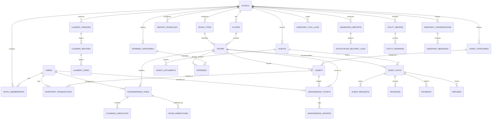

# HotelOS — Database Design & Schema Specification
**Database Engine:** PostgreSQL 16 (Authoritative Production Engine) / Async SQLite (Local Dev Fallback)  
**ORM:** SQLAlchemy 2.0 Async Declarative  
**Migration Tool:** Alembic  
**Document Version:** 2.0.0 — Production Blueprint  

---

## 1. Relational Database Architecture Overview

HotelOS uses a normalized PostgreSQL schema designed for multi-tenant isolation, immutable financial and inventory ledgers, sub-second query execution, and complete auditability.

### 1.1 Structural Conventions
1. **Primary Keys**: Every entity uses a non-enumerable UUID stored as `UUID` (PostgreSQL) or `String(36)` (portable across engines) generated via `gen_random_uuid()` or client-side UUIDv4.
2. **Monetary Precision**: All currency and financial figures strictly use **`NUMERIC(12, 2)`**. Floating-point types (`FLOAT`, `DOUBLE PRECISION`) are prohibited to eliminate IEEE 754 rounding artifacts.
3. **Timestamps**: All temporal fields use **`TIMESTAMPTZ`** stored in UTC. Local time presentation is converted to `Asia/Kolkata` (IST, UTC+5:30) at the API presentation layer.
4. **Tenant Ownership**: Every tenant-owned table features a non-nullable `hotel_id` foreign key referencing `hotels(id)` with a dedicated B-tree index.
5. **Referential Integrity**:
   - `ON DELETE RESTRICT` is enforced on financial, operational, and inventory records to preserve historical audit integrity.
   - `ON DELETE CASCADE` is reserved for dependent detail children (e.g., `cleaning_checklists` under `housekeeping_tasks`, `laundry_items` under `laundry_batches`, `hotel_memberships` under `hotels`).

---

## 2. Complete Entity Relationship Diagram (ERD)

---

## 3. Detailed Table Specifications & Constraints

### 3.1 Platform & Multi-Tenancy

#### `users`
Global platform accounts synced with authentication identity.
| Column | Type | Constraints | Description |
|---|---|---|---|
| `id` | UUID / String(36) | PRIMARY KEY | User UUID matching auth identity |
| `email` | VARCHAR(255) | NOT NULL, UNIQUE, INDEX | Official email address |
| `full_name` | VARCHAR(150) | NOT NULL | User's full name |
| `phone_number` | VARCHAR(20) | NULLABLE | Contact telephone |
| `password_hash` | VARCHAR(255) | NULLABLE | Bcrypt password hash |
| `is_active` | BOOLEAN | NOT NULL, DEFAULT TRUE | Account active flag |
| `is_platform_admin`| BOOLEAN | NOT NULL, DEFAULT FALSE | SaaS superadmin flag |
| `created_at` | TIMESTAMPTZ | NOT NULL, DEFAULT NOW() | Registration timestamp |
| `updated_at` | TIMESTAMPTZ | NOT NULL, DEFAULT NOW() | Last update timestamp |

#### `hotels`
Property tenant master profile.
| Column | Type | Constraints | Description |
|---|---|---|---|
| `id` | UUID / String(36) | PRIMARY KEY | Unique property tenant ID |
| `name` | VARCHAR(200) | NOT NULL | Official commercial name |
| `slug` | VARCHAR(100) | NOT NULL, UNIQUE, INDEX | URL-safe property slug |
| `address` | TEXT | NOT NULL | Physical street address |
| `city` | VARCHAR(100) | NOT NULL, DEFAULT 'Varanasi' | Property city |
| `state` | VARCHAR(100) | NOT NULL, DEFAULT 'Uttar Pradesh' | Property state |
| `country` | VARCHAR(100) | NOT NULL, DEFAULT 'India' | Country |
| `postal_code` | VARCHAR(20) | NOT NULL | PIN Code |
| `phone` | VARCHAR(20) | NOT NULL | Front desk phone |
| `email` | VARCHAR(255) | NOT NULL | Official communications email |
| `timezone` | VARCHAR(50) | NOT NULL, DEFAULT 'Asia/Kolkata' | Property timezone |
| `currency` | VARCHAR(10) | NOT NULL, DEFAULT 'INR' | Operating currency |
| `check_in_time` | VARCHAR(10) | NOT NULL, DEFAULT '12:00' | Standard check-in cutoff |
| `check_out_time`| VARCHAR(10) | NOT NULL, DEFAULT '11:00' | Standard check-out cutoff |
| `reporting_time`| VARCHAR(10) | NOT NULL, DEFAULT '23:59' | Night Audit cutoff |
| `is_active` | BOOLEAN | NOT NULL, DEFAULT TRUE | Property active status |
| `created_at` | TIMESTAMPTZ | NOT NULL, DEFAULT NOW() | Onboarding timestamp |
| `updated_at` | TIMESTAMPTZ | NOT NULL, DEFAULT NOW() | Profile update timestamp |

#### `hotel_memberships`
Role-based tenant association link table.
| Column | Type | Constraints | Description |
|---|---|---|---|
| `id` | UUID / String(36) | PRIMARY KEY | Membership ID |
| `user_id` | UUID / String(36) | NOT NULL, FK users(id) ON DELETE CASCADE, INDEX | User reference |
| `hotel_id` | UUID / String(36) | NOT NULL, FK hotels(id) ON DELETE CASCADE, INDEX | Hotel tenant reference |
| `role` | VARCHAR(30) | NOT NULL, CHECK (role IN ('OWNER', 'MANAGER', 'RECEPTIONIST', 'HOUSEKEEPING', 'MAINTENANCE', 'ACCOUNTANT')) | RBAC Role |
| `is_active` | BOOLEAN | NOT NULL, DEFAULT TRUE | Membership status |
| `created_at` | TIMESTAMPTZ | NOT NULL, DEFAULT NOW() | Joined timestamp |
| `updated_at` | TIMESTAMPTZ | NOT NULL, DEFAULT NOW() | Last update timestamp |
*Unique Constraint: `(user_id, hotel_id)`.*

---

### 3.2 Property Structure

#### `floors`
| Column | Type | Constraints | Description |
|---|---|---|---|
| `id` | UUID / String(36) | PRIMARY KEY | Floor ID |
| `hotel_id` | UUID / String(36) | NOT NULL, FK hotels(id) ON DELETE CASCADE, INDEX | Tenant reference |
| `floor_number` | INTEGER | NOT NULL | Numerical floor level (0, 1, 2...) |
| `name` | VARCHAR(50) | NOT NULL | Commercial wing/floor label |
| `created_at` | TIMESTAMPTZ | NOT NULL, DEFAULT NOW() | Creation timestamp |
*Unique Constraint: `(hotel_id, floor_number)`.*

#### `room_types`
| Column | Type | Constraints | Description |
|---|---|---|---|
| `id` | UUID / String(36) | PRIMARY KEY | Room Type ID |
| `hotel_id` | UUID / String(36) | NOT NULL, FK hotels(id) ON DELETE CASCADE, INDEX | Tenant reference |
| `name` | VARCHAR(100) | NOT NULL | Category name (e.g. Deluxe Heritage) |
| `base_price` | NUMERIC(12, 2) | NOT NULL, CHECK (base_price >= 0) | Standard nightly rate |
| `max_capacity` | INTEGER | NOT NULL, DEFAULT 2 | Max adult occupancy |
| `amenities` | JSONB / JSON | NOT NULL, DEFAULT '[]' | Feature tags |
| `description` | TEXT | NULLABLE | Public marketing description |
*Unique Constraint: `(hotel_id, name)`.*

#### `rooms`
| Column | Type | Constraints | Description |
|---|---|---|---|
| `id` | UUID / String(36) | PRIMARY KEY | Physical room ID |
| `hotel_id` | UUID / String(36) | NOT NULL, FK hotels(id) ON DELETE CASCADE, INDEX | Tenant reference |
| `floor_id` | UUID / String(36) | NOT NULL, FK floors(id) ON DELETE RESTRICT, INDEX | Assigned floor |
| `room_type_id` | UUID / String(36) | NOT NULL, FK room_types(id) ON DELETE RESTRICT, INDEX | Category assignment |
| `room_number` | VARCHAR(20) | NOT NULL | Key number (e.g., 101, 204B) |
| `status` | VARCHAR(30) | NOT NULL, DEFAULT 'VACANT_CLEAN', INDEX | Current state |
| `is_active` | BOOLEAN | NOT NULL, DEFAULT TRUE | Active sellable room |
| `created_at` | TIMESTAMPTZ | NOT NULL, DEFAULT NOW() | Creation timestamp |
| `updated_at` | TIMESTAMPTZ | NOT NULL, DEFAULT NOW() | Last update timestamp |
*Unique Constraint: `(hotel_id, room_number)`.*

---

### 3.3 Inventory & Asset Ledgers

#### `assets`
Physical equipment and linen items.
| Column | Type | Constraints | Description |
|---|---|---|---|
| `id` | UUID / String(36) | PRIMARY KEY | Asset ID |
| `hotel_id` | UUID / String(36) | NOT NULL, FK hotels(id) ON DELETE CASCADE, INDEX | Tenant reference |
| `category_id` | UUID / String(36) | NOT NULL, FK asset_categories(id) ON DELETE RESTRICT, INDEX | Category reference |
| `name` | VARCHAR(150) | NOT NULL | Asset item label |
| `asset_tag` | VARCHAR(50) | NULLABLE | Barcode or physical tag |
| `qr_code_identifier`| VARCHAR(100) | UNIQUE, INDEX, NULLABLE | QR scan identifier string |
| `current_location_type`| VARCHAR(30)| NOT NULL, DEFAULT 'STORAGE' | Location classification |
| `current_room_id` | UUID / String(36) | NULLABLE, FK rooms(id) ON DELETE SET NULL, INDEX | Active room assignment |
| `condition` | VARCHAR(20) | NOT NULL, DEFAULT 'GOOD' | Condition status |
| `purchase_price` | NUMERIC(12, 2) | NOT NULL, DEFAULT 0.00 | Initial cost |
| `purchase_date` | DATE | NULLABLE | Purchase date |
| `warranty_expiry`| DATE | NULLABLE | Warranty end date |
| `is_active` | BOOLEAN | NOT NULL, DEFAULT TRUE | Active asset flag |

#### `inventory_transactions`
Immutable, double-entry inventory movement ledger.
| Column | Type | Constraints | Description |
|---|---|---|---|
| `id` | UUID / String(36) | PRIMARY KEY | Transaction ID |
| `hotel_id` | UUID / String(36) | NOT NULL, FK hotels(id) ON DELETE CASCADE, INDEX | Tenant reference |
| `asset_id` | UUID / String(36) | NULLABLE, FK assets(id) ON DELETE SET NULL, INDEX | Specific asset moved |
| `category_id` | UUID / String(36) | NOT NULL, FK asset_categories(id) ON DELETE RESTRICT, INDEX | Category reference |
| `transaction_type` | VARCHAR(30) | NOT NULL | Transaction classification |
| `quantity` | INTEGER | NOT NULL, CHECK (quantity != 0) | Quantity transferred |
| `from_location` | VARCHAR(50) | NOT NULL | Origin location |
| `to_location` | VARCHAR(50) | NOT NULL | Destination location |
| `unit_cost` | NUMERIC(12, 2) | NOT NULL, DEFAULT 0.00 | Cost per unit |
| `reference_id` | UUID / String(36) | NULLABLE | Related ticket/batch/stay ID |
| `notes` | TEXT | NULLABLE | Reason or discrepancy notes |
| `performed_by_user_id`| UUID / String(36)| NOT NULL, FK users(id) ON DELETE RESTRICT | Responsible employee |
| `created_at` | TIMESTAMPTZ | NOT NULL, DEFAULT NOW(), INDEX | Ledger timestamp |

---

### 3.4 Guests, Stays & Folios

#### `guests`
| Column | Type | Constraints | Description |
|---|---|---|---|
| `id` | UUID / String(36) | PRIMARY KEY | Guest CRM ID |
| `hotel_id` | UUID / String(36) | NOT NULL, FK hotels(id) ON DELETE CASCADE, INDEX | Tenant reference |
| `full_name` | VARCHAR(150) | NOT NULL | Primary guest name |
| `email` | VARCHAR(255) | NULLABLE | Guest email |
| `phone` | VARCHAR(20) | NOT NULL, INDEX | Phone number |
| `id_type` | VARCHAR(30) | NULLABLE | ID category |
| `id_number_masked`| VARCHAR(50) | NULLABLE | Masked ID number (e.g., `XXXX9876`) |
| `nationality` | VARCHAR(50) | NOT NULL, DEFAULT 'Indian' | Nationality |
| `city` | VARCHAR(100) | NULLABLE | Origin city |
| `state` | VARCHAR(100) | NULLABLE | Origin state |
| `is_blacklisted` | BOOLEAN | NOT NULL, DEFAULT FALSE | Security blacklist flag |

#### `guest_stays`
Folio billing and room occupancy record.
| Column | Type | Constraints | Description |
|---|---|---|---|
| `id` | UUID / String(36) | PRIMARY KEY | Stay Folio ID |
| `hotel_id` | UUID / String(36) | NOT NULL, FK hotels(id) ON DELETE CASCADE, INDEX | Tenant reference |
| `guest_id` | UUID / String(36) | NOT NULL, FK guests(id) ON DELETE RESTRICT, INDEX | Guest reference |
| `room_id` | UUID / String(36) | NOT NULL, FK rooms(id) ON DELETE RESTRICT, INDEX | Allocated room |
| `check_in_time` | TIMESTAMPTZ | NOT NULL | Check-in timestamp |
| `expected_check_out_time`| TIMESTAMPTZ | NOT NULL | Scheduled checkout |
| `actual_check_out_time` | TIMESTAMPTZ | NULLABLE | Actual checkout |
| `status` | VARCHAR(20) | NOT NULL, DEFAULT 'RESERVED', INDEX | Stay status |
| `adult_count` | INTEGER | NOT NULL, DEFAULT 1, CHECK (adult_count >= 1) | Adults |
| `child_count` | INTEGER | NOT NULL, DEFAULT 0 | Children |
| `room_rate_per_night` | NUMERIC(12, 2) | NOT NULL | Agreed daily rate |
| `total_room_charge` | NUMERIC(12, 2) | NOT NULL, DEFAULT 0.00 | Accrued room tariff |
| `total_tax_charge` | NUMERIC(12, 2) | NOT NULL, DEFAULT 0.00 | Total GST accrued |
| `total_additional_charge`| NUMERIC(12, 2)| NOT NULL, DEFAULT 0.00 | Extra beds, room service |
| `total_paid` | NUMERIC(12, 2) | NOT NULL, DEFAULT 0.00 | Cumulative payments received |
| `balance_due` | NUMERIC(12, 2) | NOT NULL, DEFAULT 0.00 | Outstanding folio balance |
| `registration_token` | UUID / String(36)| NOT NULL, UNIQUE, INDEX | Public token for digital check-in |

---

### 3.5 Financial Ledgers

#### `revenues`
Accrual revenue earned per consumed room night and service.
| Column | Type | Constraints | Description |
|---|---|---|---|
| `id` | UUID / String(36) | PRIMARY KEY | Revenue entry ID |
| `hotel_id` | UUID / String(36) | NOT NULL, FK hotels(id) ON DELETE CASCADE, INDEX | Tenant reference |
| `stay_id` | UUID / String(36) | NULLABLE, FK guest_stays(id) ON DELETE SET NULL, INDEX | Stay folio reference |
| `room_id` | UUID / String(36) | NOT NULL, FK rooms(id) ON DELETE RESTRICT, INDEX | Room reference |
| `revenue_type` | VARCHAR(30) | NOT NULL | Tariff, extra bed, laundry, minibar |
| `amount` | NUMERIC(12, 2) | NOT NULL, CHECK (amount >= 0) | Pre-tax earned amount |
| `tax_amount` | NUMERIC(12, 2) | NOT NULL, DEFAULT 0.00 | GST component |
| `posting_date` | DATE | NOT NULL, DEFAULT CURRENT_DATE, INDEX | Business date posted |
| `created_at` | TIMESTAMPTZ | NOT NULL, DEFAULT NOW() | System timestamp |

#### `payments`
Cash inflow collections ledger.
| Column | Type | Constraints | Description |
|---|---|---|---|
| `id` | UUID / String(36) | PRIMARY KEY | Payment receipt ID |
| `hotel_id` | UUID / String(36) | NOT NULL, FK hotels(id) ON DELETE CASCADE, INDEX | Tenant reference |
| `stay_id` | UUID / String(36) | NOT NULL, FK guest_stays(id) ON DELETE RESTRICT, INDEX | Folio reference |
| `amount` | NUMERIC(12, 2) | NOT NULL, CHECK (amount > 0) | Amount collected |
| `payment_mode` | VARCHAR(30) | NOT NULL | `CASH`, `UPI_QR`, `CREDIT_DEBIT_CARD`, `BANK_TRANSFER` |
| `transaction_reference`| VARCHAR(100)| NULLABLE | Bank UTR / UPI reference ID |
| `collected_by_user_id` | UUID / String(36)| NOT NULL, FK users(id) ON DELETE RESTRICT | Staff member |
| `payment_date` | TIMESTAMPTZ | NOT NULL, DEFAULT NOW(), INDEX | Receipt timestamp |

#### `expenses`
Property operating expenditure vouchers.
| Column | Type | Constraints | Description |
|---|---|---|---|
| `id` | UUID / String(36) | PRIMARY KEY | Expense ID |
| `hotel_id` | UUID / String(36) | NOT NULL, FK hotels(id) ON DELETE CASCADE, INDEX | Tenant reference |
| `category_id` | UUID / String(36) | NOT NULL, FK expense_categories(id) ON DELETE RESTRICT, INDEX | Category reference |
| `room_id` | UUID / String(36) | NULLABLE, FK rooms(id) ON DELETE SET NULL, INDEX | Room if direct expense |
| `amount` | NUMERIC(12, 2) | NOT NULL, CHECK (amount > 0) | Vouched amount |
| `expense_date` | DATE | NOT NULL, DEFAULT CURRENT_DATE, INDEX | Accounting date |
| `payment_method`| VARCHAR(30) | NOT NULL | Cash, UPI, NEFT, Card, Credit Vendor |
| `invoice_url` | TEXT | NULLABLE | Scanned receipt/bill URL |
| `description` | TEXT | NOT NULL | Itemized expense description |
| `is_allocated` | BOOLEAN | NOT NULL, DEFAULT FALSE | True if shared property cost |
| `approved_by_user_id`| UUID / String(36)| NULLABLE, FK users(id) ON DELETE SET NULL | Approving manager |
| `created_at` | TIMESTAMPTZ | NOT NULL, DEFAULT NOW() | System timestamp |

---

## 4. Missing Database Entities (Migration Roadmap)

The repository inspection identified several entities required for complete commercial operations that must be added in subsequent migration revisions:

1. **`bookings`**:
   - Independent reservation entity separating future bookings from currently in-house `guest_stays`.
   - Fields: `hotel_id`, `guest_id`, `room_type_id`, `allocated_room_id`, `booking_source` (OTA, Walk-in, Direct), `rate_plan_id`, `check_in_date`, `check_out_date`, `advance_deposit_amount`, `cancellation_policy`, `status` (`CONFIRMED`, `HOLD`, `CANCELLED`).
2. **`rate_plans`**:
   - Manages meal inclusion plans (`EP`, `CP`, `MAP`, `AP`) and seasonal tariff multipliers.
3. **`vendors` & `purchase_orders`**:
   - General supplier directory beyond laundry contractors (F&B distributors, plumbing/hardware stores, linen suppliers).
   - `purchase_orders` and `purchase_order_items` for 3-way invoice reconciliation.
4. **`date_range_exclusion_constraint`**:
   - PostgreSQL `btree_gist` extension constraint on `bookings` to physically prevent overlapping room allocations at the database engine level.

