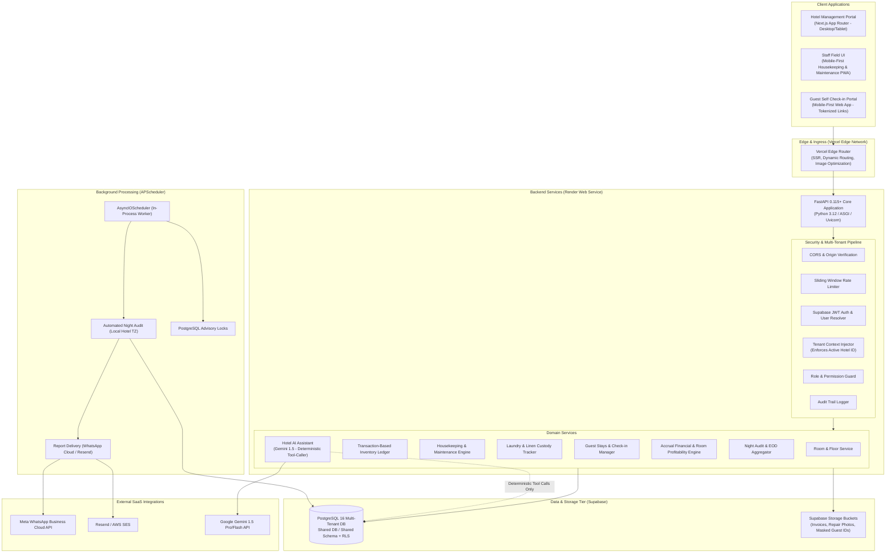
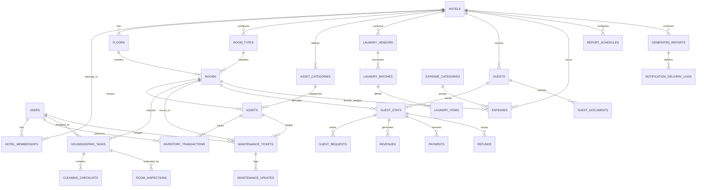

# HotelOS — Phase 0 Architecture & Engineering Specification
**Target Market:** Independent & Mid-Sized Hotels in India (Initial Launch: Varanasi, UP)  
**System Class:** Multi-Tenant B2B Hospitality SaaS  
**Author:** Lead SaaS Architect & Full-Stack Systems Engineer  
**Date:** October 2026  

---

## Executive Summary & Architectural Posture

HotelOS replaces disconnected paper registers, disjointed WhatsApp messages, and error-prone spreadsheets with an integrated, multi-tenant property operations, inventory, and financial operating system. 

This document defines the complete architectural foundation for **Phase 0**. In accordance with the project directives, **no application code is implemented until this architecture and design specification is thoroughly reviewed and approved.**

---

## 1. High-Level System Architecture

HotelOS utilizes a decoupled, modern multi-tenant cloud architecture engineered for high reliability, zero cross-tenant data leakage, sub-second API latencies, and mobile-friendly offline-tolerant front desk and staff interactions.



### Multi-Tenant Isolation Model

1. **Isolation Strategy**: Multi-tenancy with a shared database and shared schema, using a mandatory `hotel_id` UUID discriminator on every single tenant-owned table.
2. **Backend Defense-in-Depth**:
   - A dedicated FastAPI dependency (`get_tenant_context`) extracts and verifies the target hotel from the authenticated user's active membership.
   - All SQLAlchemy queries execute with an enforced `WHERE hotel_id = :current_hotel_id` filter injected at the base repository/service level.
3. **Database-Level Defense (Row Level Security)**:
   - Supabase/PostgreSQL RLS policies are attached to all hotel-specific tables.
   - Direct database access through Supabase client libraries sets `app.current_hotel_id` session settings, preventing queries from escaping the tenant boundary even if backend application code falters.
4. **Cross-Tenant Prevention**:
   - User credentials exist in a global platform space (`users`), but authorization rights exist strictly in `hotel_memberships` linked to specific `hotel_id` records.
   - Users belonging to multiple properties (e.g., an owner with properties in Varanasi and Prayagraj) can switch their active context; every API call requires an explicit `X-Hotel-ID` header validated against their active membership.

---

## 2. Proposed Directory Structures

The codebase strictly decouples the Next.js frontend from the FastAPI backend. Docker is explicitly excluded per the architectural constraints.

### 2.1 Frontend Structure (`/frontend`)

```
frontend/
├── package.json
├── tsconfig.json
├── tailwind.config.ts
├── postcss.config.js
├── next.config.mjs
├── .env.example
├── public/
│   ├── favicon.ico
│   ├── logo-hotelos.svg
│   └── placeholder/
├── src/
│   ├── app/
│   │   ├── layout.tsx                     # Root layout with fonts, theme, query provider
│   │   ├── page.tsx                       # Landing / Redirection to active hotel
│   │   ├── (auth)/
│   │   │   ├── login/page.tsx             # Supabase Auth sign-in
│   │   │   ├── register/page.tsx          # Initial onboarding
│   │   │   └── forgot-password/page.tsx
│   │   ├── (dashboard)/
│   │   └── [hotelId]/
│   │       ├── layout.tsx             # Dashboard shell: sidebar, topbar, tenant context
│   │       ├── overview/page.tsx      # Main executive dashboard
│   │       ├── rooms/
│   │       │   ├── page.tsx           # Room matrix & list view
│   │       │   └── [roomId]/page.tsx  # Detailed room 360-degree performance view
│   │       ├── inventory/
│   │       │   ├── page.tsx           # Category & stock ledger
│   │       │   ├── audit/page.tsx     # Physical audit workflow
│   │       │   └── qr/page.tsx        # QR code generator & batch printer
│   │       ├── housekeeping/
│   │       │   ├── page.tsx           # Housekeeping board & task assignment
│   │       │   └── mobile/page.tsx    # Mobile-optimized staff cleaning checklist
│   │       ├── maintenance/
│   │       │   ├── page.tsx           # Ticket list, status kanban, asset repair
│   │       │   └── new/page.tsx       # Rapid ticket creation with photo capture
│   │       ├── laundry/
│   │       │   ├── page.tsx           # Linen tracking across rooms/storage/vendors
│   │       │   └── dispatch/page.tsx  # Send/Receive batch modal workflow
│   │       ├── guests/
│   │       │   ├── page.tsx           # Guest register, active stays, check-in
│   │       │   └── [stayId]/page.tsx  # Guest folio & invoice
│   │       ├── employees/
│   │       │   ├── page.tsx           # Staff accounts, roles & daily attendance
│   │       │   └── audit-logs/page.tsx# Operational & security activity trail
│   │       ├── finance/
│   │       │   ├── page.tsx           # Financial dashboard & daily summary
│   │       │   ├── expenses/page.tsx  # Expense entry with invoice uploads
│   │       │   ├── profitability/page.tsx # Room-wise ADR, RevPAR, Operating Contribution
│   │       │   └── budgets/page.tsx   # Monthly budget vs actual
│   │       ├── procurement/
│   │       │   ├── page.tsx           # Vendors & purchase orders
│   │       │   └── orders/new/page.tsx
│   │       ├── utilities/
│   │       │   └── page.tsx           # Electricity/Water bills & meter logs
│   │       ├── reports/
│   │       │   ├── page.tsx           # Generated daily reports archive & schedules
│   │       │   └── export/page.tsx    # PDF & Excel manual generation
│   │       ├── ai/
│   │       │   └── page.tsx           # Hotel AI Assistant chat interface
│   │       └── settings/
│   │           ├── page.tsx           # Hotel profile, check-in times, timezone
│   │           └── notifications/page.tsx # WhatsApp & Email report config
│   │   └── (guest)/
│   │       └── checkin/
│   │           └── [token]/page.tsx       # Tokenized mobile-first guest digital check-in
│   ├── components/
│   │   ├── ui/                            # shadcn/ui primitives (button, card, dialog, table...)
│   │   ├── layout/
│   │   │   ├── sidebar.tsx                # Collapsible navigation with active role filters
│   │   │   ├── topbar.tsx                 # Hotel switcher, notifications, user menu
│   │   │   └── mobile-nav.tsx             # Bottom bar navigation for housekeeping/maintenance
│   │   ├── shared/
│   │   │   ├── stat-card.tsx              # KPI widget with trend indicator
│   │   │   ├── data-table.tsx             # Server-paginated, sortable, searchable table
│   │   │   ├── qr-scanner.tsx             # WebRTC camera scanner for room/asset audits
│   │   │   ├── date-range-picker.tsx      # Date range picker with preset periods
│   │   │   ├── status-badge.tsx           # Semantic color tags for room/ticket states
│   │   │   └── confirmation-dialog.tsx
│   │   └── modules/
│   │       ├── rooms/                     # Room grid, filter pills, quick-status dropdown
│   │       ├── inventory/                 # Transaction drawer, movement modal
│   │       ├── housekeeping/              # Interactive checklist items
│   │       ├── finance/                   # Revenue vs Expense charts, formula breakdowns
│   │       └── ai/                        # Streaming message bubble, tool-run indicator
│   ├── hooks/
│   │   ├── use-tenant.ts                  # Active hotel context & switchers
│   │   ├── use-permissions.ts             # Client-side permission assertion
│   │   ├── use-qr-scanner.ts              # Barcode detector wrapper
│   │   └── use-api-query.ts               # SWR / TanStack Query abstraction
│   ├── lib/
│   │   ├── api-client.ts                  # Axios / Fetch client with auth headers & error toasts
│   │   ├── supabase.ts                    # Supabase Client for client-side Auth & storage
│   │   ├── formatters.ts                  # Indian Currency (₹ Lakh/Crore), Dates, Numbers
│   │   └── permissions.ts                 # Role-permission constants
│   └── types/
│       ├── api.ts                         # Standard API Response schemas
│       ├── models.ts                      # Domain entities (Rooms, Assets, Stays, Expenses)
│       └── enums.ts                       # RoomStatus, AssetCondition, UserRole, etc.
```

---

### 2.2 Backend Structure (`/backend`)

```
backend/
├── pyproject.toml                         # Poetry / UV / Pip package configuration
├── requirements.txt                       # Locked dependencies
├── alembic.ini                            # Alembic database migration config
├── .env.example                           # Clean environment template
├── alembic/
│   ├── env.py                             # Alembic migration environment
│   └── versions/                          # Versioned migration scripts
├── app/
│   ├── __init__.py
│   ├── main.py                            # FastAPI application factory & lifespan
│   ├── core/
│   │   ├── __init__.py
│   │   ├── config.py                      # Pydantic BaseSettings (DB, JWT, WhatsApp, Gemini)
│   │   ├── database.py                    # SQLAlchemy AsyncEngine & sessionmaker
│   │   ├── security.py                    # Supabase JWT verification & password hashing
│   │   ├── dependencies.py                # Tenant context, Current User, DB session deps
│   │   ├── exceptions.py                  # Custom domain HTTP exceptions & error handlers
│   │   └── logging.py                     # Structured JSON logging
│   ├── models/                            # SQLAlchemy 2.0 declarative models
│   │   ├── __init__.py                    # Model registry for Alembic metadata
│   │   ├── base.py                        # Base model with UUID, timestamps, soft delete
│   │   ├── platform.py                    # User, Hotel, HotelMembership
│   │   ├── hotel.py                       # Floor, RoomType, Room
│   │   ├── inventory.py                   # AssetCategory, Asset, InventoryTransaction, Audit
│   │   ├── housekeeping.py                # HousekeepingTask, CleaningChecklist, Inspection
│   │   ├── maintenance.py                 # MaintenanceTicket, MaintenanceUpdate
│   │   ├── laundry.py                     # LaundryVendor, LaundryBatch, LaundryItem
│   │   ├── employee.py                    # Employee, Attendance, ActivityLog
│   │   ├── guest.py                       # Guest, GuestStay, GuestDocument, GuestRequest
│   │   ├── finance.py                     # ExpenseCategory, Expense, Revenue, Payment, Refund, Budget
│   │   ├── utility.py                     # UtilityMeter, UtilityReading
│   │   ├── reporting.py                   # ReportSchedule, GeneratedReport, NotificationLog
│   │   └── ai.py                          # AIConversation, AIMessage, AIToolLog
│   ├── schemas/                           # Pydantic v2 validation models
│   │   ├── common.py                      # Pagination, DateRangeFilter, APIResponse
│   │   ├── platform.py                    # User schemas, Hotel profile, Membership
│   │   ├── hotel.py                       # FloorCreate, RoomUpdate, RoomDetailResponse
│   │   ├── inventory.py                   # TransactionCreate, AssetFilter, AuditRequest
│   │   ├── housekeeping.py                # TaskAssignment, ChecklistUpdate
│   │   ├── maintenance.py                 # TicketCreate, TechnicianUpdate
│   │   ├── laundry.py                     # BatchDispatch, BatchReceipt
│   │   ├── guest.py                       # GuestRegistration, CheckinRequest, Folio
│   │   ├── finance.py                     # ExpenseCreate, RevenueAnalytics, ProfitabilityQuery
│   │   ├── reporting.py                   # EODReportPayload, ScheduleConfig
│   │   └── ai.py                          # ChatRequest, ChatResponse, ToolCall
│   ├── crud/                              # Database operations & queries (with tenant filtering)
│   │   ├── base.py                        # Generic CRUDBase with tenant enforcement
│   │   ├── crud_room.py
│   │   ├── crud_inventory.py
│   │   ├── crud_housekeeping.py
│   │   ├── crud_finance.py
│   │   └── crud_report.py
│   ├── services/                          # Business logic & complex transactional workflows
│   │   ├── inventory_ledger.py            # Double-entry balance calculation & audits
│   │   ├── night_audit.py                 # Room charge postings, metric aggregations
│   │   ├── profitability.py               # ADR, RevPAR, Operating Contribution calculators
│   │   ├── report_generator.py            # PDF compilation & JSON digest synthesis
│   │   ├── whatsapp_service.py            # Meta Cloud API message/document dispatch
│   │   ├── email_service.py               # Resend / SES email client
│   │   └── ai_service.py                  # Controlled tool dispatcher & LLM wrapper
│   ├── tasks/                             # Background scheduler tasks
│   │   ├── scheduler.py                   # APScheduler setup & lifecycle hooks
│   │   └── jobs.py                        # EOD runner, low-stock checks, preventive maintenance
│   └── api/
│       ├── __init__.py
│       └── v1/
│           ├── api.py                     # Master APIRouter uniting all modules
│           ├── endpoints/
│           │   ├── auth.py                # Session refresh, profile
│           │   ├── hotels.py              # Hotel profile, switchers, onboarding
│           │   ├── rooms.py               # Room CRUD, status updates, room-360
│           │   ├── inventory.py           # Assets, transactions, audits, QR
│           │   ├── housekeeping.py        # Tasks, checklists, inspections
│           │   ├── maintenance.py         # Tickets, updates, repairs
│           │   ├── laundry.py             # Batches, vendor dispatches
│           │   ├── guests.py              # Registrations, check-in/out, folios
│           │   ├── employees.py           # Staff, shifts, attendance
│           │   ├── finance.py             # Expenses, payments, budgets, room profitability
│           │   ├── utilities.py           # Readings, meter monitoring
│           │   ├── reports.py             # Daily EOD queries, on-demand exports
│           │   └── ai.py                  # Hotel Assistant conversational API
└── tests/
    ├── conftest.py                        # Pytest fixtures, test DB, mock Supabase JWT
    ├── test_tenant_isolation.py           # Security tests verifying zero cross-tenant leak
    ├── test_inventory_ledger.py           # Ledger transaction balance & audit tests
    ├── test_profitability_math.py         # ADR, RevPAR & Operating Contribution formulas
    └── test_night_audit.py                # Idempotent EOD execution tests
```

---

## 3. Database Architecture & ER Diagram

### 3.1 Entity Relationship Diagram



---

## 4. API Endpoint Specifications

All endpoints are prefixed with `/api/v1`. Authentication requires a valid Bearer Token from Supabase Auth and an `X-Hotel-ID` header specifying the active tenant.

### 4.1 Authentication & Multi-Tenant Management
- `POST /auth/sync-session` — Syncs the authenticated Supabase user profile to the `users` table.
- `GET /auth/me` — Returns user profile and associated hotel memberships.
- `GET /hotels` — Lists all hotels the user has active membership in.
- `POST /hotels` — Onboards a new hotel (Platform Admin or new Owner).
- `GET /hotels/{hotel_id}` — Retrieves hotel profile, policies, and settings.
- `PUT /hotels/{hotel_id}` — Updates hotel profile, contact, and timezone settings.

### 4.2 Room & Floor Operations
- `GET /rooms` — Matrix/list of all rooms with current status, floor, and occupancy.
- `POST /rooms` — Creates a new room (Floor & Room Type required).
- `GET /rooms/{room_id}` — Room 360-degree view (assets, current stay, housekeeping, maintenance, revenue, operating contribution).
- `PATCH /rooms/{room_id}/status` — Rapid status update (`VACANT_CLEAN`, `BLOCKED_MAINTENANCE`, etc.).
- `GET /floors` — Lists floors and room counts.
- `POST /floors` — Adds a new floor.
- `GET /room-types` — Lists room categories and base rates.
- `POST /room-types` — Creates or updates a room category.

### 4.3 Inventory & Asset Ledger
- `GET /inventory/assets` — Filterable list of physical assets with current location, condition, and QR codes.
- `POST /inventory/assets` — Registers an asset into storage or directly into a room.
- `GET /inventory/transactions` — Full immutable ledger history.
- `POST /inventory/transactions` — Records inventory movement (room allocation, laundry dispatch, damaged, discarded).
- `POST /inventory/audits` — Initiates an inventory audit for a specific room or floor.
- `POST /inventory/audits/{audit_id}/scan` — Submits scanned asset QR code with verified condition.
- `POST /inventory/audits/{audit_id}/finalize` — Concludes audit, flags discrepancies, and updates asset locations.
- `GET /inventory/qr/batch-print` — Generates printable SVG/PDF QR tags for rooms and assets.

### 4.4 Housekeeping & Field Inspections
- `GET /housekeeping/tasks` — List of daily housekeeping tasks with status and priority.
- `POST /housekeeping/tasks` — Manual or auto-assigned room cleaning task.
- `PATCH /housekeeping/tasks/{task_id}/start` — Housekeeper starts cleaning (logs start timestamp).
- `PATCH /housekeeping/tasks/{task_id}/checklist` — Checks off cleaning items.
- `PATCH /housekeeping/tasks/{task_id}/complete` — Marks room as `CLEANED` and moves to `INSPECTION_PENDING`.
- `POST /housekeeping/inspections` — Supervisor submits pass/fail inspection.

### 4.5 Maintenance & Appliance Repairs
- `GET /maintenance/tickets` — Tickets filtered by room, asset, status, or priority.
- `POST /maintenance/tickets` — Creates a ticket with optional photo upload.
- `PATCH /maintenance/tickets/{ticket_id}/assign` — Assigns technician.
- `POST /maintenance/tickets/{ticket_id}/updates` — Logs update note, repair cost, or status change.
- `PATCH /maintenance/tickets/{ticket_id}/resolve` — Resolves ticket and unblocks room if applicable.

### 4.6 Laundry & Custody Tracking
- `GET /laundry/batches` — Historical and active laundry dispatches.
- `POST /laundry/batches/dispatch` — Sends linens to vendor (creates inventory transactions).
- `POST /laundry/batches/{batch_id}/receive` — Reconciles returned items, records missing/damaged counts.
- `GET /laundry/vendors` — Lists registered laundry vendors and contract rates.

### 4.7 Guest Folio & Digital Check-In
- `POST /guests/digital-checkin/request` — Generates secure short-lived self-registration link for guest.
- `GET /guests/digital-checkin/{token}` — Public guest entry endpoint to view stay details.
- `POST /guests/digital-checkin/{token}/submit` — Submits guest details and masked ID document.
- `POST /guests/check-in` — Front desk executes check-in, allocates room, marks room `OCCUPIED`.
- `POST /guests/stays/{stay_id}/checkout` — Front desk completes folio reconciliation and check-out.
- `POST /guests/stays/{stay_id}/payments` — Records payment collection (Cash, UPI, Card).

### 4.8 Financial Management & Room Profitability
- `GET /finance/overview` — Today's and MTD revenue, expenses, and operating contribution.
- `GET /finance/expenses` — Expense ledger with category filters.
- `POST /finance/expenses` — Logs expense with receipt attachment and allocation method.
- `GET /finance/room-profitability` — Comprehensive room-by-room ADR, RevPAR, and Operating Contribution table.
- `GET /finance/scenario-calculator` — Computes simulated profitability based on hypothetical price, occupancy, and utility costs.

### 4.9 Reporting & Notifications
- `GET /reports/daily` — Queries generated EOD report data for a specific date.
- `POST /reports/daily/trigger-audit` — Manually triggers Night Audit and EOD report compilation.
- `GET /reports/daily/{report_id}/pdf` — Downloads compiled PDF report.
- `GET /reports/settings` — Returns automated report schedule and WhatsApp/Email recipient config.
- `PUT /reports/settings` — Updates delivery times and phone numbers.

### 4.10 AI Hotel Assistant
- `POST /ai/chat` — Accepts conversational prompt, executes deterministic backend tools, and returns fact-grounded answer with citations.
- `GET /ai/conversations` — Retrieves conversation history for the authenticated user.

---

## 5. Granular Role & Permission Matrix (RBAC)

| Resource / Action | Owner | Manager | Receptionist | Housekeeping | Maintenance | Accountant | Admin (Platform) |
| :--- | :---: | :---: | :---: | :---: | :---: | :---: | :---: |
| **Hotel Profile & Settings** | Full | Read-Only | No Access | No Access | No Access | No Access | Full |
| **Room Creation & Pricing** | Full | Full | Read-Only | No Access | No Access | Read-Only | Full |
| **Room Status Override** | Full | Full | Occupied/Vacant | Clean/Inspect | Block/Unblock | No Access | Full |
| **Guest Check-in / Check-out**| Full | Full | Full | No Access | No Access | Read-Only | Audit Only |
| **Guest PII & Documents** | Full | Full | Verify Only | No Access | No Access | Folio Only | Masked Only |
| **Financial Dashboards & P&L** | Full | Authorized Only | No Access | No Access | No Access | Full | Subscription Only |
| **Expense Creation & Approvals**| Full | Approvals | No Access | No Access | Tickets Only | Entry/Reconcile | No Access |
| **Inventory Movement Ledger** | Full | Full | Read-Only | Request/Return | Repair Parts | Audit/Cost | Audit Only |
| **Inventory Audits & Scans** | Full | Full | No Access | Room Audit | Asset Audit | Audit Review | No Access |
| **Housekeeping Assignments** | Full | Full | View Readiness | Assigned Tasks| No Access | No Access | No Access |
| **Maintenance Ticket Creation**| Full | Full | Full | Report Damaged | Resolve Assigned| View Repair Costs| No Access |
| **Laundry Dispatch & Receipt** | Full | Full | No Access | Linens Only | No Access | Invoice Reconcile | No Access |
| **Automated Daily Reports** | Full | Full | No Access | No Access | No Access | Financial Copy | System Logs |
| **AI Assistant (Data Scope)** | Full Hotel | Operations/Rooms| Stays/Rooms Only| My Tasks Only | My Tickets Only| Financials Only | Platform Metrics |

---

## 6. Critical Technical Risks, Flawed Requirement Analysis & Recommendations

In accordance with Section 13 ("Challenge requirements that could create unnecessary complexity or unreliable financial calculations. Recommend practical engineering decisions and explain why"), the following critical architectural challenges are identified:

### 1. Challenge: Room-Wise Utility Metering in Independent Indian Hotels
- **The Pitfall**: Most budget and mid-sized hotels in Varanasi operate on a single central commercial electricity and water meter. Asking hotel staff to log "room-wise electricity consumption" without sub-meters forces staff to enter fabricated numbers, corrupting financial reporting.
- **Architectural Decision**: 
  - Central utility bills are recorded at the **Hotel Level**.
  - If a room has a dedicated sub-meter (IoT or digital), direct consumption is recorded.
  - If no sub-meter exists, utility costs are distributed as **Allocated Operating Expenses** based on weighted occupied room-nights:
    $$\text{Allocated Utility Cost}_{\text{room}} = \text{Total Utility Bill} \times \left(\frac{\text{Room Occupied Nights}}{\sum \text{Total Occupied Nights}}\right)$$
  - In the UI, this figure is explicitly flagged with an `Allocated` badge rather than a `Measured` badge.

### 2. Challenge: Confusing Net Profit with Operating Contribution
- **The Pitfall**: Labeling room-level financial contribution as "Net Profit" creates severe tax and legal liability for hotel owners. Net profit must account for debt servicing, building depreciation, corporate overheads, promoter draws, and corporate income taxes.
- **Architectural Decision**:
  - Adopt the **USALI (Uniform System of Accounts for the Lodging Industry)** standard.
  - Calculate strictly:
    $$\text{Operating Contribution} = \text{Room Revenue} - \text{Direct Room Expenses} - \text{Allocated Operational Expenses}$$
  - The UI will explicitly display **"Operating Contribution (GOP Level)"** and include an informational tooltip explaining the formula.

### 3. Challenge: Accrual Revenue vs. Cash Flow Double-Counting
- **The Pitfall**: In hospitality, guests frequently pay an advance upon booking, pay a second installment during check-in, and clear remaining charges at check-out. If revenue is computed from cash receipts, room tariff is double-counted on the day of payment while showing zero revenue on consumed days.
- **Architectural Decision**:
  - Complete separation of the **Revenue Ledger (Accrual)** and the **Payments Ledger (Cash Flow)**.
  - Room tariff is earned and posted nightly during the **Night Audit**.
  - Payments are recorded as ledger credits against the guest folio balance.
  - The Owner Dashboard clearly shows three distinct financial metrics:
    1. **Earned Revenue (Accrual)**
    2. **Cash Inflow (Payments Collected)**
    3. **Accounts Receivable (Pending Folios)**

### 4. Challenge: Overwriting Inventory Stock vs. Immutable Ledger
- **The Pitfall**: Storing a simple `stock_quantity` integer on an asset row and incrementing/decrementing it directly results in phantom stock, race conditions, untraceable theft, and inability to reconcile linen loss between rooms, storage, and laundry.
- **Architectural Decision**:
  - Implement an **Immutable Transaction-Based Ledger** (`inventory_transactions`).
  - Current stock at any location is a deterministic materialized aggregate of transactions. Every single movement requires an authenticated `user_id`, source, destination, and quantity.

### 5. Challenge: Direct SQL AI Execution vs. Deterministic Tool Calling
- **The Pitfall**: Allowing an LLM (Gemini) to write arbitrary SQL (Text-to-SQL) against a multi-tenant database is a major security vulnerability: prompt injection can leak neighboring hotels' financials or corrupt data.
- **Architectural Decision**:
  - The AI Assistant has **zero access to raw SQL execution**.
  - The assistant communicates exclusively through a strict whitelist of typed Pydantic tool functions (`get_daily_occupancy`, `get_asset_discrepancies`, `get_unpaid_folios`).
  - The backend server automatically injects the active, verified `hotel_id` from the user's session into the tool execution parameters, making cross-tenant data leakage impossible.

---

## 7. Phased Implementation Roadmap

- **PHASE 0 (CURRENT)**: System Architecture, Directory Blueprints, Database ERD & Schemas, API Design, Security & DPDP Compliance, Risk Analysis.
- **PHASE 1 — Foundation & Multi-Tenant Core**: Next.js & FastAPI scaffolding, Supabase Auth integration, multi-tenant middleware, hotel onboarding, floor/room creation, Owner dashboard skeleton.
- **PHASE 2 — Inventory & Asset Tracking**: Asset category master, immutable transaction ledger, QR code generator and camera scanner, physical audit discrepancy workflow.
- **PHASE 3 — Operations (Housekeeping, Maintenance, Laundry)**: Mobile-first housekeeping checklist, inspection workflow, maintenance ticketing with photo upload, linen custody tracking with laundry batches.
- **PHASE 4 — Financial Management & Room Profitability**: Expense entry with invoice uploads, ADR/RevPAR/Operating Contribution mathematical engine, monthly budgets vs actuals, room performance matrix.
- **PHASE 5 — Guest Management & Digital Check-In**: Tokenized mobile-first guest check-in portal, masked ID verification, guest folio, front-desk check-in/out workflows.
- **PHASE 6 — Automated Daily Reporting**: Night Audit cron job, EOD report compilation, high-resolution PDF generation, WhatsApp Business Cloud API delivery, Resend email dispatch.
- **PHASE 7 — AI Hotel Assistant**: Gemini API integration, deterministic tool calling with tenant isolation, natural language operational and financial queries.
- **PHASE 8 — Production Hardening & Deployment**: Security audit, end-to-end integration tests, load testing, Vercel & Render deployment, Supabase backup verification.

---

## Phase 0 Sign-Off Request

Phase 0 documentation is complete. Per the project directives, **implementation will not proceed until this architectural plan is reviewed and approved.**

