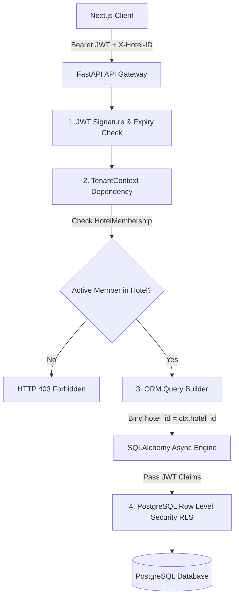

# HotelOS — Security, Multi-Tenant Isolation & DPDP Compliance
**Version:** 1.0.0-PROD  
**Legal Framework:** Indian Digital Personal Data Protection Act (DPDP Act 2023)  
**Security Standard:** OWASP Top 10 API Security Compliance & ISO 27001 Principle Alignment  
**Target Platform:** Multi-Tenant Hospitality Operating System

---

## 1. Multi-Tenant Isolation Architecture

HotelOS implements a **defense-in-depth multi-tenant isolation model** ensuring that data belonging to one hotel can never be read, modified, or leaked to another property under any circumstance.



### 1.1 Four-Layer Isolation Defense

1. **Authentication Layer (Supabase JWT):**
   Every incoming HTTP request must include a cryptographically valid `Authorization: Bearer <token>` signed by Supabase Auth (RS256/HS256). The token verifies user identity, expiration, and account status.
2. **Context Resolution Layer (`TenantContext` Dependency):**
   The backend extracts the property identifier from the `X-Hotel-ID` header. The dependency `get_tenant_context` executes a query against `hotel_memberships` verifying that `(user_id, hotel_id, is_active=True)` exists. If no active membership is found, the request is halted before reaching any business logic.
3. **Application & ORM Layer (Mandatory Filter Predicates):**
   All SQLAlchemy queries and write statements explicitly append `WHERE table.hotel_id == ctx.hotel_id`. No entity query is executed without tenant scoping.
4. **Database Engine Layer (PostgreSQL Row Level Security):**
   PostgreSQL RLS policies on all 32 tenant tables inspect the session's active hotel claim:
   ```sql
   CREATE POLICY hotel_isolation_policy ON rooms
   FOR ALL
   USING (hotel_id = (current_setting('app.current_hotel_id', true))::uuid);
   ```

---

## 2. Indian DPDP Act 2023 Compliance & Guest Privacy

HotelOS is purpose-built to comply with India's **Digital Personal Data Protection Act, 2023 (DPDP Act)** governing the processing of personal data for Indian hotel guests.

### 2.1 Aadhaar & Identity Document Protection
1. **Strict Masking:**
   - Raw 12-digit Aadhaar numbers are **never stored** in plain text in any database table, log file, or cache.
   - Front Desk forms mask inputs client-side, and the backend re-validates and redacts inputs before storage:
     $$\text{Masked Aadhaar} = \text{"XXXXXXXX"} + \text{Last 4 Digits}$$
   - Example: `5678 1234 9012` is stored strictly as `XXXXXXXX9012`.
2. **HMAC Deduplication Hash:**
   To identify returning guests without storing plain-text identity numbers, a salted SHA-256 HMAC hash is generated using a server-side hardware security module (HSM) pepper:
   $$\text{Guest Hash} = \text{HMAC-SHA256}(\text{Salt} \parallel \text{Raw ID}, \text{Secret Pepper})$$
3. **Private Document Storage:**
   - Guest ID photo scans are uploaded directly to a **private** Supabase Storage bucket (`hotelos-docs-private`).
   - Public access is disabled at the bucket level.
   - When an authorized staff member (`OWNER`, `MANAGER`, `RECEPTIONIST`) views a guest document, the backend generates a **time-limited presigned URL expiring in 15 minutes** (900 seconds).

### 2.2 Automated Data Retention & Auto-Purge Protocol
Under DPDP Section 8(7), personal data must not be retained beyond the period necessary to serve its stated operational or legal purpose.
- HotelOS provisions an `auto_purge_at` timestamp on every `guest_documents` record:
  $$\text{auto\_purge\_at} = \text{guest\_stay.actual\_check\_out\_time} + 30\text{ days}$$
- A scheduled daily background task purges expired identity scans from Supabase Storage and clears document paths from the database, preventing indefinite storage of sensitive citizen identity cards.

---

## 3. AI Hotel Assistant Security & Prompt Injection Defense

The AI Hotel Assistant interacts with hotel data through strict security boundaries to prevent cross-tenant leaks, unauthorized financial disclosures, and prompt injection exploits.

### 3.1 Strict Prohibition of Text-to-SQL
> [!CAUTION]
> **Zero Raw SQL Execution:** The AI Assistant is **strictly prohibited** from generating or executing raw SQL queries against the database. Converting LLM text directly to SQL creates catastrophic vulnerabilities including SQL injection, unauthorized table drops, and cross-tenant leakage.

### 3.2 Parameterized Tool Architecture
The AI Assistant operates exclusively through **hardcoded, parameterized Python tool functions**:
- `get_occupancy_metrics(hotel_id: str)`
- `get_financial_metrics(hotel_id: str, start_date: date, end_date: date)`
- `get_dirty_rooms(hotel_id: str)`
- `get_pending_maintenance(hotel_id: str)`
- `get_low_stock_linens(hotel_id: str)`

#### Security Enforcements:
1. **Server-Bound Hotel ID:** The `hotel_id` argument is injected directly from the verified server-side `TenantContext`. The LLM has no capability to pass or alter the `hotel_id`.
2. **Role-Gated Execution:** If a Receptionist prompts the assistant: *"What was our net operating contribution this month?"*, the tool executor checks `ctx.role`. Because `RECEPTIONIST` lacks the `OWNER`, `MANAGER`, or `ACCOUNTANT` role, the tool call fails immediately with an authorization rejection, preventing unauthorized financial disclosure.
3. **Context Isolation:** Assistant conversation histories are scoped strictly to `(user_id, hotel_id)`.

---

## 4. API Security, Cryptography & Network Hardening

### 4.1 Cryptographic Tokens for Digital Self Check-In
- Check-in registration links use cryptographically secure 32-byte pseudo-random hexadecimal strings:
  `registration_token = secrets.token_hex(32)`
- Tokens provide unguessable (256-bit entropy) access to a single stay check-in page without requiring guest authentication.
- Once the guest completes registration and front desk marks the stay as `CHECKED_IN`, the token is invalidated.

### 4.2 Transport Security & CORS
- **TLS 1.3:** Enforced on all Render API endpoints and Vercel web endpoints. HTTP requests are redirected to HTTPS with HSTS headers.
- **Strict CORS Origin Whitelisting:**
  ```python
  origins = [
      "https://app.hotelos.in",
      "https://hotelos.vercel.app",
      "http://localhost:3000"  # Development only
  ]
  ```
- **Rate Limiting:** Authentication routes (`/auth/login`, `/auth/register`) enforce IP-based rate limiting (5 attempts/minute) to mitigate credential stuffing and brute-force attacks.

