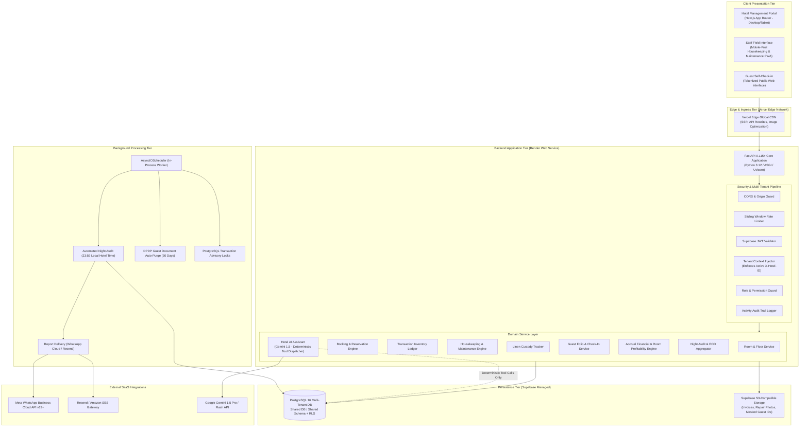

# HotelOS — System Architecture Specification
**System Class:** Multi-Tenant B2B Hospitality SaaS Platform  
**Target Infrastructure:** Vercel (Edge/Frontend) + Render (FastAPI Web Service) + Supabase (PostgreSQL & Storage)  
**Document Version:** 2.0.0 — Production Blueprint  

---

## 1. High-Level Architectural Topology

HotelOS adopts a decoupled cloud-native architecture engineered for sub-second response times, strict multi-tenant isolation, resilience against intermittent network drops in Indian hotel back-offices, and high operational reliability.



---

## 2. Multi-Tenant Isolation Model

HotelOS uses a **Shared Database, Shared Schema with Mandatory Tenant Discriminator and Defense-in-Depth RLS** architecture.

### 2.1 Multi-Tenant Guarantees
1. **Mandatory Tenant Discriminator**: Every tenant-owned database table includes an indexed `hotel_id UUID` column with non-nullable constraints.
2. **FastAPI Dependency Injection (`get_tenant_context`)**:
   - Every API request requiring tenant context inspects the `X-Hotel-ID` header.
   - The security dependency resolves the authenticated user's ID from the validated JWT.
   - It executes a join between `hotel_memberships` and `hotels` where `user_id = current_user.id`, `hotel_id = x_hotel_id`, and `is_active = true`.
   - If no active membership is found, the request immediately terminates with `HTTP 403 Forbidden`.
   - Platform administrators with `is_platform_admin = true` bypass membership checks while maintaining the target `hotel_id` scope.
3. **ORM Base Query Filtering**:
   - Domain CRUD services enforce a base filter `WHERE hotel_id = :current_hotel_id` across all `SELECT`, `UPDATE`, and `DELETE` queries.
4. **PostgreSQL Row Level Security (RLS)**:
   - For direct database client access or emergency fallbacks, PostgreSQL RLS policies enforce tenant boundaries:
     ```sql
     ALTER TABLE rooms ENABLE ROW LEVEL SECURITY;
     CREATE POLICY tenant_isolation_rooms ON rooms
         FOR ALL
         USING (hotel_id = NULLIF(current_setting('app.current_hotel_id', true), '')::uuid);
     ```

---

## 3. Frontend Architecture (Next.js App Router)

The frontend is built using Next.js 14 App Router, React 18, TypeScript, Tailwind CSS, and shadcn/ui.

### 3.1 Routing & Layout Hierarchy
```
src/app/
├── layout.tsx                    # Root layout with Inter font and AuthProvider
├── page.tsx                      # Root router: redirects to /overview or /login
├── (auth)/
│   ├── login/page.tsx            # Supabase Auth sign-in with 1-click Demo credentials
│   └── register/page.tsx         # User registration
├── onboard/page.tsx              # First-time hotel property onboarding wizard
├── (dashboard)/
│   ├── layout.tsx                # Dashboard shell: Sidebar, Topbar, TenantContext
│   ├── overview/page.tsx         # Executive Owner KPIs, 7-Day Performance Chart
│   ├── rooms/page.tsx            # Room Matrix grid, Floor tabs, Room 360 modal
│   ├── inventory/page.tsx        # Asset master, QR codes, Double-entry transaction ledger
│   ├── housekeeping/page.tsx     # Cleaning task board, Checklist modal, Inspections
│   ├── maintenance/page.tsx      # Repair tickets, technician cost updates, unblocking
│   ├── laundry/page.tsx          # 3-way linen custody, batch dispatch & reconciliation
│   ├── guests/page.tsx           # Front desk check-in, checkout settlement, digital links
│   ├── finance/page.tsx          # Accrual P&L, Expense vouchers, Room profitability, Simulator
│   ├── utilities/page.tsx        # Electricity and water commercial meter reading logs
│   ├── reports/page.tsx          # Night Audit trigger, PDF compilation, WhatsApp schedules
│   ├── ai/page.tsx               # Hotel AI Assistant with live grounded database queries
│   └── settings/page.tsx         # Hotel profile, check-in/out policies, team RBAC
└── checkin/[token]/page.tsx      # Public tokenized mobile-first guest self check-in
```

### 3.2 State Management & Client-Server Data Boundary
- **Authentication State**: Managed via React Context (`AuthProvider`) in [`frontend/src/context/auth-context.tsx`](file:///c:/Users/lap/Desktop/hotel/frontend/src/context/auth-context.tsx). Persists session tokens, active hotel membership, and user profile with automatic local storage synchronization.
- **API Client Layer**: Handled by [`frontend/src/lib/api.ts`](file:///c:/Users/lap/Desktop/hotel/frontend/src/lib/api.ts). Automatically injects `Authorization: Bearer <token>` and `X-Hotel-ID: <active_hotel_id>` on all requests.
- **Server Communication**: Client components invoke REST API endpoints with optimistic state updates for rapid user interaction, falling back to server-reconciled data.

---

## 4. Backend Architecture (FastAPI & Clean Domain Services)

The backend follows a layered domain architecture separating API contracts, authorization guards, business services, and database persistence.

### 4.1 Layer Responsibilities
1. **API Routers (`app/api/v1/endpoints/`)**: Handle HTTP verb mapping, parameter validation via Pydantic schemas, status codes, and route documentation.
2. **Security & Dependencies (`app/core/dependencies.py`)**: Stateless JWT decoding, role verification (`require_roles`), and tenant context injection.
3. **Business Services (`app/services/`)**:
   - `inventory_ledger.py`: Enforces double-entry ledger rules for stock movements.
   - `night_audit.py`: Executes automated accrual tariff posting and daily KPI aggregations.
   - `profitability.py`: Computes ADR, RevPAR, direct repair expenses, allocated utility charges, and USALI operating contribution.
   - `report_generator.py`: Generates high-resolution vector PDF reports via ReportLab.
   - `ai_service.py`: Intent classification and deterministic database tool calling.
4. **Data Persistence (`app/models/models.py`)**: SQLAlchemy 2.0 declarative models mapped to PostgreSQL with async execution via `asyncpg` / `aiosqlite`.

---

## 5. Background Scheduler & Night Audit Engine

### 5.1 In-Process Async Scheduler (APScheduler)
- HotelOS utilizes an `AsyncIOScheduler` embedded within the FastAPI application lifecycle, eliminating the operational complexity and memory footprint of Redis/Celery for initial deployments.
- **Night Audit Cron**: Executes daily at each hotel's configured reporting time (default `23:59:00 Asia/Kolkata`).
- **Idempotency & Advisory Locks**:
  - Before executing the audit, the worker acquires a PostgreSQL transaction-level advisory lock:
    ```sql
    SELECT pg_try_advisory_xact_lock(hashtext('night_audit_' || :hotel_id || '_' || :audit_date));
    ```
  - If the lock is held or if a `generated_reports` record already exists for the date, the job cleanly exits without duplicating room charge postings.
- **Automatic Document Purge Cron**: Executes daily at 03:00 UTC to hard-delete guest identity documents whose `auto_purge_at` timestamp has passed, complying with the Indian DPDP Act 2023.

---

## 6. External Integrations Architecture

### 6.1 Meta WhatsApp Business Cloud API
- **Endpoint**: `https://graph.facebook.com/v19.0/{phone_number_id}/messages`
- **Authentication**: System User Permanent Access Token stored in environment variables.
- **Payload**: Dispatches pre-approved transactional WhatsApp template messages containing:
  - Today's Occupancy %, Earned Revenue, Cash Inflows, Expenses, and Operating Contribution.
  - Signed URL link for downloading the compiled daily PDF audit report.

### 6.2 Transactional Email (Resend / AWS SES)
- **Engine**: REST API calls to Resend (`https://api.resend.com/emails`) or AWS SES SDK.
- **Payload**: Multipart MIME email containing an HTML executive digest and the high-resolution ReportLab PDF as a file attachment.

### 6.3 Google Gemini 1.5 API (Hotel AI Assistant)
- **Model**: `gemini-1.5-flash` for low-latency operational lookups; `gemini-1.5-pro` for complex financial scenario analysis.
- **Execution Mode**: Deterministic Function / Tool Calling only. The LLM receives typed JSON schemas of available backend queries and returns structured tool call requests. The backend executes the query with the user's active `hotel_id` injected, returning verified records to the LLM for natural language synthesis.

